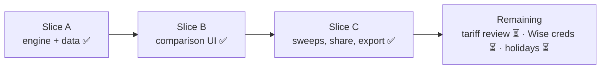

# Stablecoin Cross-Border Payment Simulator (CSI4900)

Research web app answering: **under what transaction sizes and market conditions can a native-USDC route deliver
more recipient money and/or faster usable settlement than a conventional cross-border payment?**

It compares bank-balance → recipient-bank-balance routes for a fixed total sender debit, using live public
order books, daily reference FX, live chain conditions and versioned tariffs. It never moves money, places orders,
or creates accounts. Every result is a **simulation / estimate, not a payment quote**.

Spec: [Stablecoin_Cross_Border_Simulator_Spec.md](Stablecoin_Cross_Border_Simulator_Spec.md).

## Status (2026-11-10)



63 API tests pass offline; Playwright happy-path on fixtures. Spec §9 slices are implemented; the spec's
"Base and Ethereum" initial networks have since grown to 13.

## What's covered

| | |
|---|---|
| Fiat / countries | CAD (CA), USD (US), EUR (DE, FR, NL, ES), GBP (GB), JPY (JP) |
| Exchanges (live public books, dynamic symbol discovery) | **Kraken Pro, Coinbase Advanced, Bitstamp, Binance, OKX, Bybit EU** — incl. inverse books (Binance `EUR/USDC`) and Coinbase's 1:1 USD↔USDC conversion |
| Native-USDC networks | **Ethereum, Base, Arbitrum One, OP Mainnet, Polygon PoS, Avalanche C-Chain, Linea, Solana, Stellar, Algorand, Sui, Aptos, Noble** |
| Explicitly excluded networks | TRON (native USDC discontinued), BNB Smart Chain (bridged, not native) |
| Conventional comparators | Wise (live display quote with partner credentials; otherwise labelled assumed tariff), retail bank SWIFT wire (explicit assumptions) |
| Reference FX | ECB euro reference rates (primary), Bank of Canada Valet (cross-check) |
| Chain conditions | EVM `eth_feeHistory`, Solana prioritization fees, Stellar Horizon fee stats; gas-token prices from Kraken |

The router searches every **sender venue × recipient venue × shared native network × funding/payout rail**
(e.g. *Kraken (Interac) → USDC on Solana → Bybit EU (SEPA)*), about 140 priced routes for CAD→EUR. Each route has
machine-readable exclusion reasons when it doesn't apply. No USDC/JPY book exists at any catalogued venue, so JPY
corridors show conventional routes and explain why the USDC legs are missing.

## Run locally

```bash
# API (Python 3.12+)
cd services/api
python3 -m venv .venv && .venv/bin/pip install -r requirements-dev.txt
.venv/bin/uvicorn app.main:app --port 8000          # DATA_MODE=fixture for offline recorded data
```

```bash
# Web (Node 20.9+), from repo root
npm install
npm run dev:web                                       # http://localhost:3000 (proxies /api/v1 to :8000)
```

```bash
# Or everything incl. PostgreSQL
docker compose -f infra/docker-compose.yml up --build
```

## Tests and checks

```bash
cd services/api && .venv/bin/python -m pytest -q     # unit + fixture-backed API tests (no network)
npm run contracts:check                              # generated TS types match the FastAPI OpenAPI
npm run typecheck && (cd apps/web && npx eslint .)
cd apps/web && npx playwright test                   # end-to-end happy path on fixed data
```

## Repository

```
apps/web            Next.js (App Router) + Tailwind; hand-built SVG charts (route map, frontier, sweep, heatmap)
services/api        FastAPI, Pydantic, httpx, SQLAlchemy; Decimal pricing engine
  app/adapters      ecb/boc (fx.py), exchanges.py, network.py, wise.py, http.py (cache, breaker, record/replay)
  app/catalog       versioned tariffs, rails, venues, networks, capabilities (seed.py)
  app/pricing       order-book traversal, calendar-aware timing
  app/routing       route graph + leg pricing (engine.py), objectives/Pareto (rank.py)
  app/sensitivity   amount sweeps, crossovers, stress heatmap
  fixtures/http     recorded real upstream payloads (python -m scripts.record_fixtures)
packages/contracts  TypeScript types generated from OpenAPI (npm run contracts)
infra               Docker Compose
docs                architecture, sources & credentials, tariff review
```

## Docs

- [Architecture](docs/architecture.md)
- [Sources & credentials setup](docs/sources-and-credentials.md)
- [Tariff review procedure](docs/tariff-review.md)
- [Spec](Stablecoin_Cross_Border_Simulator_Spec.md) (original brief; README/architecture reflect current state)
- Methodology and known data gaps: the in-app **Methodology** page (`/methodology`); OpenAPI at `http://localhost:8000/docs`.

## Important limitations

- Tariff and capability seeds are compiled from provider docs and secondary sources. Until a human reviews each one
  (see the tariff review procedure), every recommendation is labelled a **research scenario**, not a current real-world route.
- Wise is an assumed tariff unless `WISE_API_TOKEN` (partner credentials) is configured. Bank-wire FX margin and fees
  are explicit assumptions.
- Public holidays, per-user tiers/limits and first-transfer verification holds are not modelled.
- Not financial advice.
