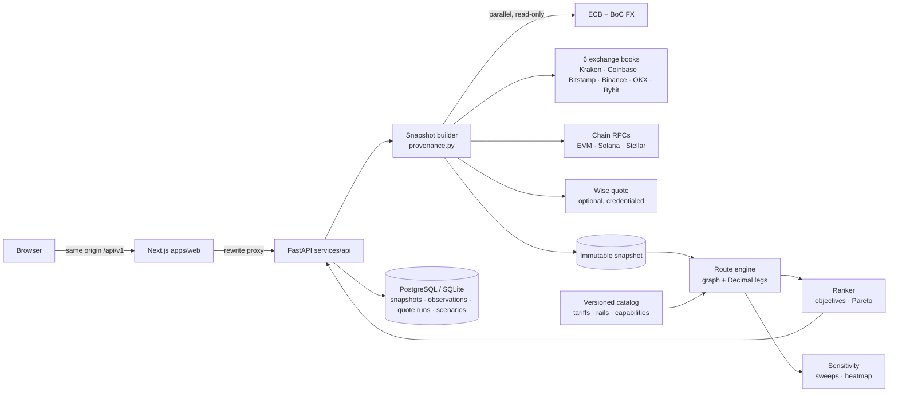
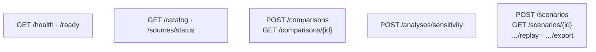

# Architecture

## API (`/api/v1`)

All `POST`s are rate-limited per client IP (`RATE_LIMIT_PER_MINUTE`, default 60 → `429`). `X-Forwarded-For` is
honoured only from `TRUSTED_PROXIES`. Market-assumption overrides and sweep grids are bounded (`422` when out of range).

## Request flow

1. `POST /api/v1/comparisons` validates inputs against the catalog (country ↔ currency, rails per country, limits).
2. The snapshot builder fetches, in parallel: ECB/BoC reference FX, each venue's USDC/fiat market list (dynamic
   symbol discovery) and order books for the two currencies involved, chain fee conditions, and optionally a Wise
   display quote. Failures become `SourceError`s; nothing is back-filled.
3. Snapshots get content-addressed IDs (identical cached observations → the same stored snapshot). Observations
   are also written to an append-only `observations` table.
4. The engine enumerates whitelisted templates: Wise, bank SWIFT wire, and every
   `venue₁ × funding rail × native network × venue₂ × payout rail` USDC path. Each leg transforms a Decimal
   amount in the unit actually charged and records duration, schedule, source IDs, status and assumptions.
5. The ranker picks the objective winner (`MOST_RECEIVED`, `FASTEST`, `WITHIN_DEADLINE`), the most-received and
   fastest-known routes, and the Pareto frontier over (recipient amount, typical time).
6. The response and request (with the start time pinned) are stored as a `QuoteRun`, so
   `GET /scenarios/{id}/replay` recomputes identical results from the retained snapshot.

## Freshness and reliability

| Source | Cache | Expiry for "current" use |
|---|---|---|
| Order books | 15 s | 60 s after fetch (else `STALE_PRICE`) |
| Market lists | 1 h | — |
| Chain conditions | 30 s | 60 s |
| ECB / BoC | 1 h | observation date + 4 days (weekends) |

Every adapter shares `HttpSource`: per-request timeout, one retry, a circuit breaker (3 failures → 30 s open),
no secrets in error messages, and record/replay (`DATA_MODE=record|fixture`).

## Key invariants

- Money is `Decimal`, serialized as decimal strings; rounding happens only at currency/venue precision (floor).
- Buys walk asks and sells walk bids, for either book orientation. Depth exhaustion and the price-impact cap reject
  the route. No top-of-book fill is ever invented.
- An exchange's USDC withdrawal fee covers gas. The live gas estimate is informational and never added on top.
- `all_in_cost = A − recipient / R`. The fee breakdown's implied line is the residual after explicit fees, so the
  spread and trading fee are never double counted.
- A route with any unknown material leg duration has `duration.known = false` and is never ranked "fastest".
- Grade `current` requires live prices, documented capabilities, reviewed tariffs and no overrides. Anything else
  is `research`.

## Scaling notes

Single-instance demo: an in-process TTL cache and SQLite. For multiple API workers, use PostgreSQL
(`DATABASE_URL`) and a shared cache (Redis) in place of the in-process cache in `adapters/http.py`. Tables are
created with `create_all`. Introduce Alembic migrations before the schema changes in production.
